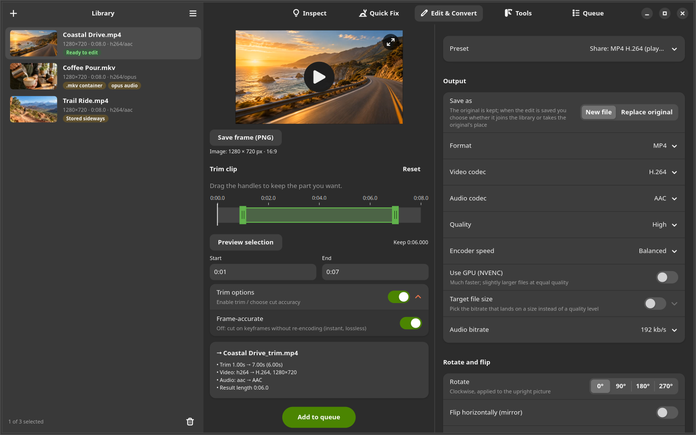
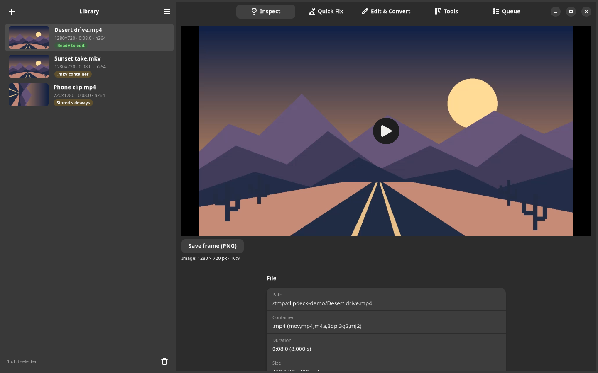
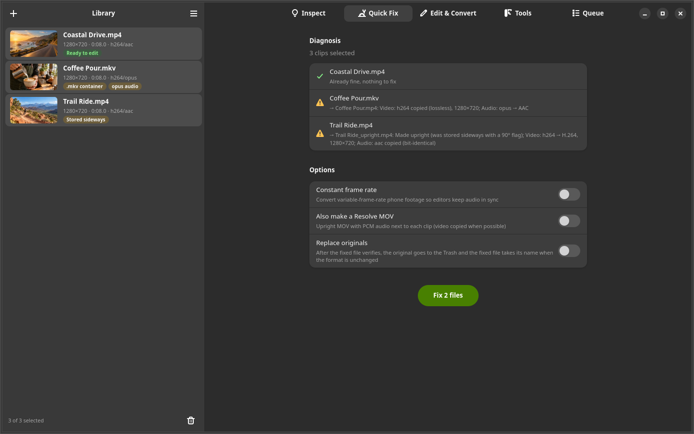
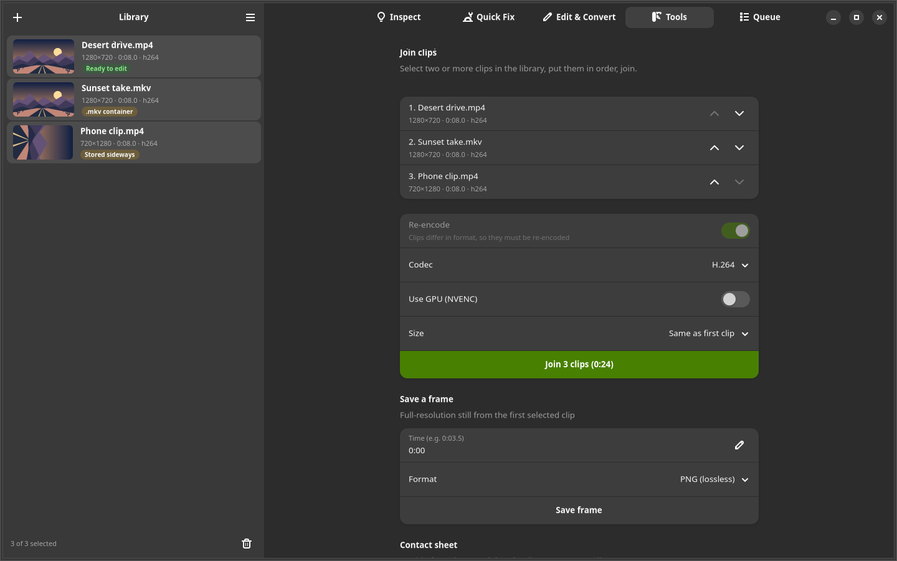
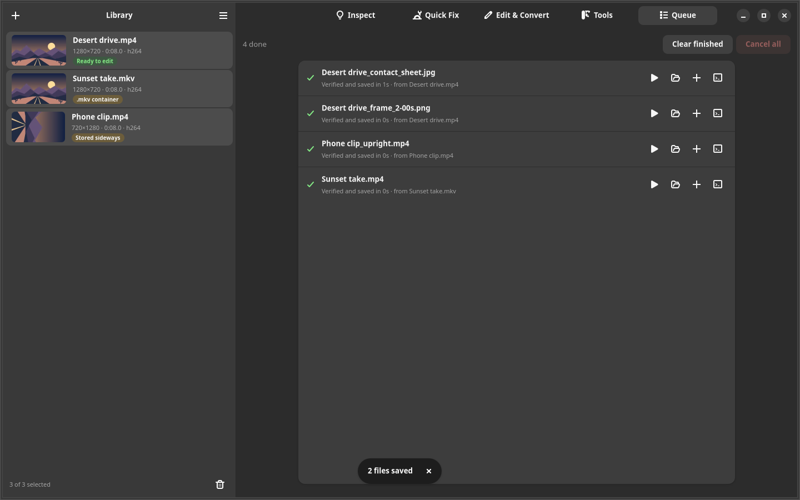

<p align="center">
  
</p>

<h1 align="center">Clipdeck</h1>

<p align="center"><strong>Fix your footage. Make the cut. Check the result.</strong></p>

<p align="center">
  A local video toolkit for the GNOME desktop.<br>
  Trim, crop, rotate, convert, and batch-fix clips—with verification before saving.
</p>

<p align="center">
  <a href="#get-started">Get started</a> ·
  <a href="#what-you-can-do">Features</a> ·
  <a href="#screenshot-tour">Screenshots</a> ·
  <a href="#presets-and-output-formats">Formats</a> ·
  <a href="#how-clipdeck-protects-your-work">Verification</a> ·
  <a href="#troubleshooting">Troubleshooting</a> ·
  <a href="https://github.com/VincentAZ/clipdeck/issues">Report a bug</a>
</p>



<p align="center"><sub>The real app, using generated demo footage. Your files stay on your machine.</sub></p>

## From awkward clip to usable video

A phone video plays sideways. A recording arrives in the wrong container. An audio
codec refuses to cooperate with your editor. You need a shorter clip, a smaller
file, or one clean frame.

Clipdeck puts those everyday jobs in one GTK4/libadwaita interface, backed by
FFmpeg. Add your files, see what needs attention, choose an operation, and inspect
the plan before adding it to the queue. Work on one clip or a batch.

**No account, uploads, or cloud processing.** Clipdeck runs locally with your
installed media tools.

## What you can do

| Your task | In Clipdeck |
| --- | --- |
| **Fix a folder of problem clips** | Quick Fix diagnoses rotation, container, video codec, audio codec, and frame-rate issues, then shows the proposed changes. |
| **Make a clean cut** | Scrub the preview, drag trim handles, enter precise times, and choose frame-accurate or lossless keyframe cuts. |
| **Reframe the shot** | Draw and adjust a crop, use aspect-ratio shortcuts, detect black bars, rotate, flip, and resize. |
| **Prepare a file for sharing** | Choose H.264, HEVC, or WebM presets, adjust quality, or target a file size. |
| **Prepare footage for editing** | Export MOV with PCM audio, DNxHR HQ, or ProRes 422 HQ. |
| **Adjust timing and sound** | Change frame rate or speed; mute, normalize, boost, or extract audio. |
| **Finish small media jobs** | Join compatible clips losslessly, re-encode mixed clips, save full-resolution frames, build contact sheets, or make GIFs. |
| **Control the export** | Strip metadata, choose an output folder, use available NVIDIA NVENC encoders, and run jobs in parallel. |

## Screenshot tour

The Edit & Convert screenshot above shows the preview, trim range, export settings,
and output plan. The other four main pages are shown below. All screenshots come
from the current application with generated, non-personal demo clips.

### Inspect: understand the file before changing it



Inspect combines playback with file and stream details, detected issues, and a
full-resolution PNG frame-export button.

### Quick Fix: diagnose first, then fix in a batch



Quick Fix explains the proposed change for each selected clip. Enable constant
frame rate or an additional Resolve MOV when needed; replacement is optional.

### Tools: join clips, save frames, and build contact sheets



Reorder clips before joining them, export a frame at a specified time, or scroll
down to choose the rows, columns, and thumbnail size for a contact sheet.

### Queue: follow each job through verification



Completed jobs offer controls to open the output, show its folder, add it to the
library, or inspect its log. Running jobs can be cancelled individually or together.

## Presets and output formats

Start with a preset in **Edit & Convert**, then adjust the settings for your files.

| Preset | Starting point |
| --- | --- |
| Share | MP4 with H.264 video and AAC audio |
| Smaller | MP4 with HEVC video and balanced quality |
| Chat & email | A 9.5 MB target, H.264/AAC, and 720p sizing |
| DaVinci Resolve | MOV with PCM audio; copy video when possible |
| DaVinci Resolve (free on Linux) | DNxHR HQ video and PCM audio in MOV |
| Editing master | ProRes 422 HQ video and PCM audio in MOV |
| Web | WebM with VP9 video and Opus audio |
| Remux to MKV | Copy compatible streams without re-encoding; MKV sources retain subtitles |
| Animated GIF | GIF output with frame-rate and width controls |
| Audio: MP3 / WAV | MP3 extraction or 24-bit PCM WAV |
| Custom | Configure the individual output and processing options |

The format selector also supports outputs beyond the named presets:

| Output | Available encoding choices |
| --- | --- |
| MP4 | H.264, HEVC, AV1; AAC or MP3 audio |
| MOV | H.264, HEVC, ProRes, DNxHR; PCM or AAC audio |
| MKV | H.264, HEVC, AV1, VP9; AAC, Opus, FLAC, or MP3 audio |
| WebM | VP9 or AV1; Opus audio |
| Audio only | MP3, M4A/AAC, WAV, FLAC, Opus |
| Still images | PNG or JPEG through Tools; PNG below video previews |

Input recognition includes MP4, MOV, MKV, WebM, AVI, transport streams, and common
audio formats. Actual decoding and encoding support comes from your installed
FFmpeg build. **Automatic** chooses a suitable codec or copies a stream where
possible; **Copy** is available when the container and requested edits permit it.

Optional processing includes deinterlacing, stabilization, denoising, rotation and
flips, crop and resize, frame-rate conversion, and audio normalization or gain.

## How Clipdeck protects your work

An FFmpeg process exiting successfully is only the beginning of a successful job.

- **Check the output against the plan.** Depending on the operation, verification
  checks codecs, dimensions, rotation, duration, audio tracks, frame counts, and
  stream hashes when streams are copied.
- **Decode it, too.** Thorough verification is on by default and adds a full decode
  and source frame-count comparisons where applicable. It takes extra time; you
  can turn it off in Preferences.
- **Keep existing files.** New outputs get an available name, such as
  `clip (2).mp4`. A file that fails verification is kept with a `.BAD` marker for
  inspection and the job is reported as failed.
- **Replace deliberately.** When you enable *Replace originals*, the original
  moves to the desktop Trash only after the new file passes verification.
- **Clean up interrupted work.** Cancellation and normal shutdown remove partial
  files. A journal lets the next launch clean up work left by a crash.

The Queue page shows progress, cancellation controls, results, warnings, and the
FFmpeg log for each job.

## Get started

Clipdeck currently runs from a source checkout on Linux. It uses **Python 3.10+**,
**GTK4**, **libadwaita 1.7+**, **PyGObject**, **FFmpeg**, and **ffprobe**.
Video previews also need the relevant GStreamer decoders.

On Debian/Ubuntu systems whose repositories provide those versions:

```bash
sudo apt install git ffmpeg python3-gi gir1.2-adw-1 gstreamer1.0-libav

git clone https://github.com/VincentAZ/clipdeck.git
cd clipdeck
./install.sh
```

Launch **Clipdeck** from your application menu, or open files from a terminal:

```bash
clipdeck
clipdeck /path/to/video.mp4 /path/to/another.mov
```

You can also drag files or folders onto the window, use **Add Videos**, or choose
Clipdeck from your file manager’s **Open With** menu.

> The installer checks for libadwaita 1.7 or newer. An older distribution may need
> newer system packages. Available codecs and GPU acceleration depend on your
> FFmpeg build and hardware; development checks currently use FFmpeg 8.0.1.

### Your first export

1. **Add a clip.** Inspect shows its media details and any detected problems.
2. **Choose your job.** Use Quick Fix for compatibility issues, Edit & Convert for
   individual adjustments or presets, and Tools for joins, frames, and contact sheets.
3. **Read the plan and queue it.** Clipdeck processes and verifies the result.
   Open the output or reveal it in your file manager from Queue.

By default, outputs go beside their originals. Preferences lets you choose a
single output folder, verification depth, and the number of parallel jobs.

### Common workflows

**Batch-fix phone clips or recordings.** Add files or a folder, select the clips,
and open Quick Fix. Read each diagnosis, choose any extra options, then press
**Fix files**. Clips already considered compatible do not need a repair job.

**Trim and crop for sharing.** Select a clip in Edit & Convert and choose Share.
Drag the trim handles or enter start/end times. Enable Crop to draw and reposition
a selection, or use an aspect shortcut. Check the preview and summary, then add
the job to the queue. With several clips selected, the settings apply as a batch;
the preview comes from the first usable selected video.

**Join a sequence.** Select at least two clips and open Tools. Use the arrow
controls to put them in order. Compatible clips can be joined without re-encoding;
mixed formats require re-encoding, with codec and size controls available.

**Export frames or a contact sheet.** Use **Save frame (PNG)** beneath a video
preview for its current position. Tools also accepts a specific frame time and
offers PNG/JPEG output. Contact sheets use a configurable grid of evenly spaced
frames and produce one JPEG per selected clip.

### Preferences and local files

| Setting or file | Behavior |
| --- | --- |
| Output location | Save beside each original or in one chosen folder. If that folder is unavailable, Clipdeck falls back beside the originals and reports it. |
| Thorough verification | Enabled by default; adds decoding and applicable frame-count checks. |
| Jobs at once | 1–4 parallel jobs; one is the default. More jobs are most useful for stream-copy or GPU work. |
| Preferences | `~/.config/clipdeck/settings.json` remembers output choices, the last folder, and processing preferences. |
| Interrupted-job journal | `~/.config/clipdeck/in-progress.txt` records temporary work paths for cleanup. |
| Thumbnails | `~/.cache/clipdeck/thumbs/` stores previews generated from your clips. |

Configuration and cache locations follow `XDG_CONFIG_HOME` and `XDG_CACHE_HOME`
when set. The queue and library are session-based; restarting does not restore a
saved job queue. Logs and Inspect can contain source filenames, local paths, and
media metadata, so review them before sharing screenshots or bug reports.

### Update or uninstall

The launcher uses this checkout directly. Keep the folder in place and update it
with:

```bash
git pull --ff-only
```

To remove the launcher, application-menu entry, and icon:

```bash
./install.sh --uninstall
```

Uninstalling leaves preferences in `~/.config/clipdeck` and thumbnails in
`~/.cache/clipdeck`.

## A few useful details

- **Lossless trimming follows keyframes.** Choose frame-accurate trimming when
  exact cut boundaries matter; that requires re-encoding.
- **Lossless frame-rate changes alter playback speed.** Keeping every compressed
  frame while changing 60 fps to 30 fps doubles the duration. Audio is re-encoded
  to stay in sync. This mode requires a constant-rate source, MP4/MOV output, and
  no conflicting video edits.
- **File-size targets are checked.** Clipdeck can retry an oversized encode at a
  lower bitrate. Very small targets still depend on the source and encoder; check
  the job’s warnings.
- **Metadata stripping is optional.** It removes mapped metadata and chapters;
  it does not remove identifying content visible or audible in the media itself.
- **Frame exports respect the crop.** Save a PNG from Inspect or Edit & Convert
  at the current preview position. Edit exports include the enabled crop.

## Troubleshooting

| Symptom | What to check |
| --- | --- |
| Installer reports missing tools | Install FFmpeg, ffprobe, PyGObject, and the GTK4/libadwaita packages above. Check `ffmpeg -version` and `ffprobe -version`. |
| `No module named gi` | Use the system Python with the distribution's `python3-gi` package. An isolated virtual environment may not see system GI bindings. |
| libadwaita version check fails | Clipdeck requires 1.7 or newer. Installing the package on an older distribution does not guarantee a sufficiently recent version. |
| `clipdeck: command not found` | Open it from the application menu, run `~/.local/bin/clipdeck` with the default install, or run `python3 -m clipdeck` from the checkout. Ensure the launcher directory is on `PATH`. |
| Launcher stopped working after moving the checkout | Run `./install.sh` again from its new location. The launcher points to the checkout used at installation time. |
| Preview is blank or cannot play a codec | Check GStreamer decoder availability, including `gstreamer1.0-libav`. Preview playback and FFmpeg processing use different media stacks. |
| GPU encoding is unavailable or fails | NVENC needs a supported NVIDIA GPU, working drivers, and an FFmpeg build with that encoder. Disable **Use GPU (NVENC)** to use CPU encoding. |
| A job fails or creates a `.BAD` file | Open its Queue log to see the command, verification failures, and warnings. Inspect the retained file; a failed result is not presented as successful. |
| Replace originals could not move a file | Check the job warning and desktop Trash support (`gio trash`). The original is kept if trashing fails. |
| An export takes longer than expected | Re-encoding, stabilization, and thorough verification add work. Check the plan for stream copying versus encoding and avoid oversubscribing the CPU with parallel jobs. |

## Keyboard shortcuts

| Shortcut | Action |
| --- | --- |
| <kbd>Ctrl</kbd> + <kbd>O</kbd> | Add videos |
| <kbd>Alt</kbd> + <kbd>1</kbd> … <kbd>5</kbd> | Switch pages |
| <kbd>Delete</kbd> | Remove selected clips from the focused library list; keep the files |
| <kbd>Ctrl</kbd> + <kbd>,</kbd> | Preferences |
| <kbd>Ctrl</kbd> + <kbd>Q</kbd> | Quit |

## Development

Run directly from the repository:

```bash
python3 -m clipdeck
```

The engine tests create synthetic media and exercise real FFmpeg operations.
The UI tests drive the actual GTK app under Xvfb, including crop, trim, frame
saving, queue operations, and window layouts.

```bash
# Xvfb is needed for the headless UI checks.
sudo apt install xvfb xauth

./run-tests.sh

# Or run just the engine checks:
python3 -m unittest tests.test_engine
```

Current validation: the engine suite runs 150 tests, with two NVENC-dependent
skips on the development machine. The crop, trim, and frame-export UI tests pass.
The full UI scenario completes its interaction checks, but its strict warning check
still reports GStreamer stream-start/segment warnings in the development environment.

| Code | Responsibility |
| --- | --- |
| `clipdeck/media.py` | Probe files and diagnose issues |
| `clipdeck/ops.py` | Turn an operation into an FFmpeg plan and verification expectations |
| `clipdeck/runner.py` | Execute, verify, and save results |
| `clipdeck/jobs.py` | Schedule work, cancellation, and dependencies |
| `clipdeck/ui/` | GTK4/libadwaita interface |

Found a problem? [Open an issue](https://github.com/VincentAZ/clipdeck/issues) with
reproduction steps, your distribution, FFmpeg version, and the relevant job log.
Remove private paths and metadata from logs before posting them. Small synthetic
or non-sensitive sample files are especially helpful.

---

Built by [VincentAZ](https://github.com/VincentAZ).
